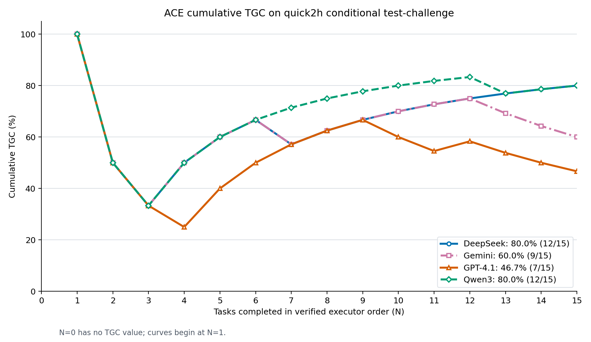

# Cumulative TGC on quick2h conditional test-challenge



The x-axis is the prefix length `N` in
[`quick2h_conditional_test_challenge.txt`](../../data/datasets/quick2h_conditional_test_challenge.txt)
order. For each model and `N = 1, ..., 15`, the plotted value is

```text
TGC(N) = 100 * number of successful tasks among the first N tasks / N
```

This is also the actual executor order. All four model configs list the same
15 task IDs in this order. The runner uses that explicit list, and the ACE
adaptation agent calls `solve_task` sequentially. We checked each model's
`Task ID` start markers in its run log: all 15 match the dataset order, with
the final `15 of 15 tasks completed` marker. The plotting script repeats this
log check and stops if an execution order differs.

Success is the boolean `individual[task_id].success` in each run's official
`evaluations/quick2h_conditional_test_challenge.json`. The x-axis starts at
0, but there is no point at 0 because TGC(0) is undefined. Only the 15
challenge-test tasks are used.

| Model | Final TGC | Successful tasks | Failed positions and task IDs |
| --- | ---: | ---: | --- |
| DeepSeek | 80.0% | 12/15 | 2: `07bb666_2`; 3: `07bb666_3`; 7: `6d59d90_1` |
| Gemini | 60.0% | 9/15 | 2: `07bb666_2`; 3: `07bb666_3`; 7: `6d59d90_1`; 13–15: `321ec38_{1,2,3}` |
| GPT-4.1 | 46.7% | 7/15 | 2: `07bb666_2`; 3: `07bb666_3`; 4: `b0934aa_1`; 10–11: `a3ba388_{1,2}`; 13–15: `321ec38_{1,2,3}` |
| Qwen3 | 80.0% | 12/15 | 2: `07bb666_2`; 3: `07bb666_3`; 13: `321ec38_1` |

Downloads: [PNG](quick2h_conditional_test_challenge_cumulative_tgc.png),
[PDF](quick2h_conditional_test_challenge_cumulative_tgc.pdf),
[SVG](quick2h_conditional_test_challenge_cumulative_tgc.svg), and
[task-level CSV](quick2h_conditional_test_challenge_cumulative_tgc.csv).
Reproduce with
[`plot_quick2h_conditional_tgc.py`](../code/plot_quick2h_conditional_tgc.py)
using `--split test_challenge`.

The existing
[`appworld_quick2h_conditional_online_baseline_report.md`](../../reports/appworld_quick2h_conditional_online_baseline_report.md)
lists 73.3% for ACE DeepSeek on challenge test. The specified DeepSeek run's
official evaluation JSON reports 80.0% with 12 of 15 task successes, which is
the source used here. This prefix average describes observed results in task
order; it does not by itself establish a causal learning effect.
