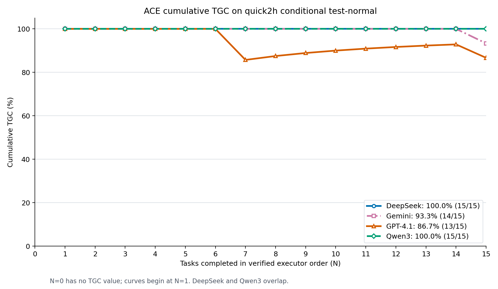

# Cumulative TGC on quick2h conditional test-normal



The x-axis is the prefix length `N` in
[`quick2h_conditional_test_normal.txt`](../../data/datasets/quick2h_conditional_test_normal.txt)
order. For each model and `N = 1, ..., 15`, the plotted value is

```text
TGC(N) = 100 * number of successful tasks among the first N tasks / N
```

This is also the actual executor order. All four model configs list the same
15 task IDs in this order. The runner uses that explicit list, and the ACE
adaptation agent calls `solve_task` sequentially. We checked each model's
`Task ID` start markers in its run log: all 15 match the dataset order, with
the final `15 of 15 tasks completed` marker. The plotting script repeats this
log check and stops if an execution order differs.

Success is the boolean `individual[task_id].success` in each run's official
`evaluations/quick2h_conditional_test_normal.json`. The x-axis starts at 0
as requested, but there is no point at 0 because TGC(0) is undefined. Only
the 15 normal-test tasks are used. DeepSeek and Qwen3 have identical 100% curves.

| Model | Final TGC | Successful tasks | Failed positions and task IDs |
| --- | ---: | ---: | --- |
| DeepSeek | 100.0% | 15/15 | None |
| Gemini | 93.3% | 14/15 | 15: `3aa1a22_3` |
| GPT-4.1 | 86.7% | 13/15 | 7: `3b8fb7a_1`; 15: `3aa1a22_3` |
| Qwen3 | 100.0% | 15/15 | None |

Downloads: [PNG](quick2h_conditional_test_normal_cumulative_tgc.png),
[PDF](quick2h_conditional_test_normal_cumulative_tgc.pdf),
[SVG](quick2h_conditional_test_normal_cumulative_tgc.svg), and
[task-level CSV](quick2h_conditional_test_normal_cumulative_tgc.csv).
Reproduce with
[`plot_quick2h_conditional_tgc.py`](../code/plot_quick2h_conditional_tgc.py)
using `--split test_normal` (the default).

The existing
[`appworld_quick2h_conditional_online_baseline_report.md`](../../reports/appworld_quick2h_conditional_online_baseline_report.md)
lists 93.3% for ACE DeepSeek on normal test. The specified DeepSeek run's
official evaluation JSON reports 100.0% with all 15 task successes, which is
the source used here. This prefix average describes observed results in task
order; it does not by itself establish a causal learning effect.
